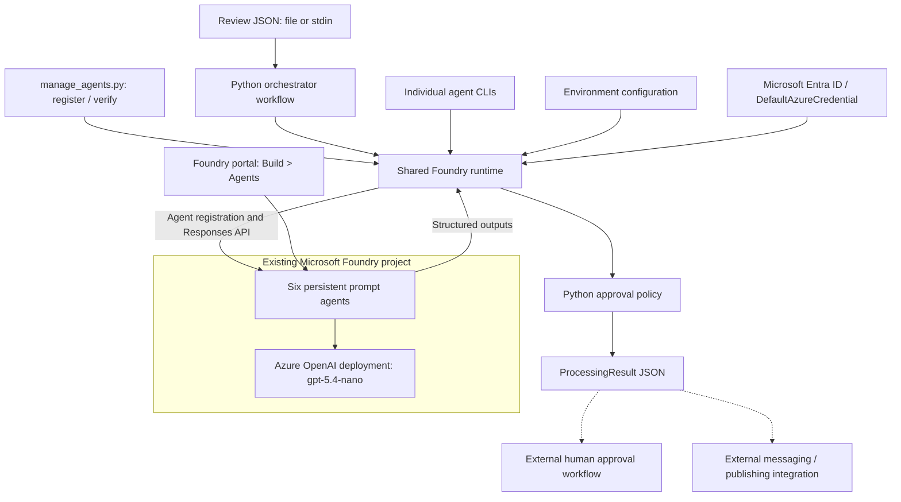
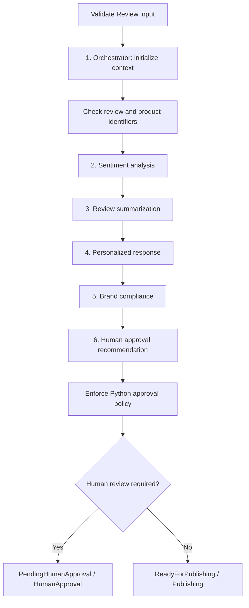

# Customer Review Analyzer Architecture

## 1. Purpose And Scope

Customer Review Analyzer implements the six agents described in
[ReadMe.md](ReadMe.md) as separate Python projects. Together, they analyze a
customer review, summarize feedback, draft a response, check compliance, and
determine whether human approval is required.

The implementation uses Microsoft Foundry Agent Service and Azure OpenAI through
the Azure AI Projects SDK and agent-bound OpenAI Responses API. Each agent is a
persistent **prompt-agent definition** in Foundry after registration. The Python
projects are registration and invocation clients; they are not deployed Python
containers or independently running HTTP services.

This document describes the implemented architecture. Database ingestion,
durable messaging, a manager approval application, and response publishing remain
external integration points. See [SETUP.md](SETUP.md) for installation and use.

## 2. System Architecture



Solid arrows show implemented interactions. Dashed arrows show integration
boundaries, not existing queue delivery or publishing. All six agent definitions
can share one Foundry project and one Azure OpenAI deployment.

## 3. Repository And Project Structure

```text
CustomerReviewAnalyzer/
|-- agents/
|   |-- review-orchestrator/
|   |-- sentiment-analysis/
|   |-- review-summarization/
|   |-- personalized-response/
|   |-- brand-compliance/
|   `-- human-approval/
|-- packages/
|   `-- foundry-review-core/
|-- examples/review.json
|-- .vscode/
|-- .env.example
|-- pyproject.toml
|-- uv.lock
|-- manage_agents.py
|-- ReadMe.md
|-- SETUP.md
`-- Architecture.md
```

Each agent directory contains its own build definition, source package, and CLI
entry point. The root workspace groups these projects for dependency resolution
and local development. It is not another agent or a deployed service.

### Project Catalog

| Project | Definition | Python Package / Command | Dependencies |
|---------|------------|--------------------------|--------------|
| Review Orchestrator | Initializes context and coordinates the full review workflow. | `review_orchestrator_agent` / `review-orchestrator-agent` | Shared core; all five specialist agents at runtime through Foundry. |
| Sentiment Analysis | Classifies sentiment and identifies issues and sensitive content. | `sentiment_analysis_agent` / `sentiment-analysis-agent` | Shared core; its registered Foundry agent and model deployment. |
| Review Summarization | Produces a concise factual summary and feedback themes. | `review_summarization_agent` / `review-summarization-agent` | Shared core; its registered Foundry agent and model deployment. |
| Personalized Response | Drafts a public response using review context and analysis. | `personalized_response_agent` / `personalized-response-agent` | Shared core; sentiment and summary data supplied as input. |
| Brand Compliance | Checks the response against review evidence, brand guidance, and safety rules. | `brand_compliance_agent` / `brand-compliance-agent` | Shared core; review, sentiment, summary, and response data. |
| Human Approval | Recommends automated eligibility or escalation; never acts as a human approver. | `human_approval_agent` / `human-approval-agent` | Shared core; review, sentiment, response, and compliance data; deterministic policy. |
| Foundry Review Core | Reuses SDK integration, configuration, contracts, CLI handling, and approval rules. | `foundry_review_core` | Azure AI Projects, Azure Identity, OpenAI, Pydantic, python-dotenv. |

The shared core is a supporting Python package, not a seventh agent. Every agent
project directly declares `foundry-review-core` as its package dependency.
Agent projects **do not import each other**. A runtime data dependency is not a
Python package dependency: the orchestrator invokes specialists by their
registered Foundry names, and individual specialists accept typed input data
without invoking upstream agents themselves.

## 4. Agent Definitions

### 4.1 Review Orchestrator

- **Project:** [Build definition](agents/review-orchestrator/pyproject.toml).
- **Source:** [Agent definition](agents/review-orchestrator/src/review_orchestrator_agent/__init__.py)
  and [workflow](agents/review-orchestrator/src/review_orchestrator_agent/workflow.py).
- **Default Foundry name:** `ulta-review-orchestrator`.
- **Input:** `Review`, including identifiers, text, metadata, and trusted VIP status.
- **Agent output:** `ProcessingContext`, with identifiers, `Received` status, and context notes.
- **Workflow output:** `ProcessingResult`, containing all stage outputs, routing, and a message payload.
- **Behavior:** `run` initializes context only; `process` executes the six-stage
  workflow. Python checks that the returned review and product identities are unchanged.

The remote orchestrator prompt has no specialist-calling tools. Coordination is
implemented by the Python workflow, not by a chat with that agent in the portal.

### 4.2 Sentiment Analysis

- **Project:** [Build definition](agents/sentiment-analysis/pyproject.toml).
- **Source:** [Agent definition](agents/sentiment-analysis/src/sentiment_analysis_agent/__init__.py).
- **Default Foundry name:** `ulta-sentiment-analysis`.
- **Input:** `Review`.
- **Output:** `SentimentResult`: `Positive`, `Neutral`, or `Negative`, confidence,
  detected issues, and independent toxicity, legal-complaint, and safety flags.
- **Behavior:** Grounds classification in the review and lowers confidence when
  meaning is ambiguous. The result informs response generation and approval routing.

### 4.3 Review Summarization

- **Project:** [Build definition](agents/review-summarization/pyproject.toml).
- **Source:** [Agent definition](agents/review-summarization/src/review_summarization_agent/__init__.py).
- **Default Foundry name:** `ulta-review-summarization`.
- **Input:** `Review`.
- **Output:** `SummaryResult`: review summary, positive themes, and negative themes.
- **Behavior:** Preserves factual feedback without inventing product-wide trends,
  and is instructed to omit personally identifying information.

### 4.4 Personalized Response

- **Project:** [Build definition](agents/personalized-response/pyproject.toml).
- **Source:** [Agent definition](agents/personalized-response/src/personalized_response_agent/__init__.py).
- **Default Foundry name:** `ulta-personalized-response`.
- **Input:** `ResponseInput`: review, sentiment result, and summary result.
- **Output:** `ResponseResult`: generated public response and confidence.
- **Behavior:** Drafts a warm, factual acknowledgment aligned with context and
  sentiment. Instructions prohibit unsupported claims, private customer details,
  medical advice, and invented promises or completed actions.

### 4.5 Brand Compliance

- **Project:** [Build definition](agents/brand-compliance/pyproject.toml).
- **Source:** [Agent definition](agents/brand-compliance/src/brand_compliance_agent/__init__.py).
- **Default Foundry name:** `ulta-brand-compliance`.
- **Input:** `ComplianceInput`: review, sentiment, summary, and generated response.
- **Output:** `ComplianceResult`: pass/fail decision, issues, and explanation.
- **Behavior:** Independently checks evidence, tone, unsupported claims, offensive
  language, liability statements, and PII exposure. Supplied product metadata may
  include brand guidelines and compliance requirements. This is an AI assessment,
  not legal certification.

### 4.6 Human Approval

- **Project:** [Build definition](agents/human-approval/pyproject.toml).
- **Source:** [Agent definition](agents/human-approval/src/human_approval_agent/__init__.py).
- **Default Foundry name:** `ulta-human-approval`.
- **Input:** `ApprovalInput`: review, sentiment, response, and compliance result.
  The runtime also supplies the configured confidence threshold.
- **Output:** `ApprovalResult`: human-review requirement, approval status, and reasons.
- **Behavior:** Recommends escalation for sensitive cases. Python subsequently
  enforces non-bypassable routing rules on both standalone CLI and workflow calls.

`Approved` means eligible for automated publishing, not that a manager approved a
sensitive response. `PendingHumanApproval` requires an external human decision.

## 5. Shared Core And Dependencies

The [shared build definition](packages/foundry-review-core/pyproject.toml) declares
the following direct dependencies. All projects require Python 3.11 or newer.

| Dependency | Declared Range | Architectural Role |
|------------|----------------|--------------------|
| `azure-ai-projects` | `>=2.3.0,<3` | Foundry project client, persistent agent versions, and agent-bound OpenAI clients. |
| `azure-identity` | `>=1.25.0,<2` | `DefaultAzureCredential` for Microsoft Entra authentication. |
| `openai` | `>=2,<3` | Responses API, structured-output parsing, and API errors. |
| `pydantic` | `>=2.12,<3` | Input/output contracts, JSON schemas, and validation. |
| `python-dotenv` | `>=1.1,<2` | Local environment-file loading. |
| `hatchling` | Build dependency | Builds the shared package and each agent project. |

The root [workspace definition](pyproject.toml) resolves the core package from
the local workspace. The [lockfile](uv.lock) records concrete dependency versions,
including transitive packages. These package versions are separate from the
Azure OpenAI model deployment name.

| Shared Module | Responsibility |
|---------------|----------------|
| [runtime.py](packages/foundry-review-core/src/foundry_review_core/runtime.py) | Loads settings, manages SDK clients, registers agent versions, and invokes agents with structured outputs. |
| [models.py](packages/foundry-review-core/src/foundry_review_core/models.py) | Defines review, stage input/output, and workflow contracts. |
| [policy.py](packages/foundry-review-core/src/foundry_review_core/policy.py) | Applies deterministic human-approval rules. |
| [cli.py](packages/foundry-review-core/src/foundry_review_core/cli.py) | Implements common registration and invocation commands, input loading, and error reporting. |

## 6. Processing And Data Flow



The stages run sequentially. The original review remains available to downstream
agents; sentiment and summary feed response generation, and compliance evaluates
the actual draft. Human-approval routing receives the review, sentiment, response,
and compliance output.

The final `ProcessingResult` contains processing context, sentiment analysis,
summary, response, compliance, approval, workflow status, destination, completed
stages, and a message matching the README's business fields:

```json
{
  "reviewId": "RVW-12345",
  "productId": "PRD-5001",
  "sentiment": "Negative",
  "reviewSummary": "Customer reported packaging and irritation concerns.",
  "generatedResponse": "Thank you for sharing your experience.",
  "approvalStatus": "PendingHumanApproval",
  "createdTimestamp": "2026-10-20T15:00:00+00:00"
}
```

This is a returned payload, not evidence of Service Bus delivery. Workflow state
exists in the running Python process and final output; it is not durably stored.
Invalid input, identity mismatch, agent errors, refusals, or incomplete/invalid
structured outputs stop processing without returning an approved workflow result.

## 7. Approval And Security Boundaries

Python requires human review when any of these conditions applies:

- Negative sentiment.
- Trusted `isVip` input is true.
- Toxic content, legal complaint, or product safety flag.
- Sentiment or response confidence below the configured threshold.
- Failed compliance or a nonempty compliance issue list.
- Agent-requested escalation, pending status, or supplied approval reasons.

These gates cannot be relaxed by a model recommendation, but semantic detection
still depends on model quality. Portal chats do not execute the Python policy and
must not be used directly as an automated publishing endpoint.

All agent instructions treat review content, metadata, and prior outputs as
untrusted data. Instructions discourage invented facts, private-data disclosure,
and false claims about completed actions. These are model instructions, not a
guarantee against prompt injection or data leakage. An ingestion service must
derive VIP status from trusted records and minimize customer metadata sent to
Foundry. Production access control and retention policies remain deployment concerns.

## 8. Configuration And Azure Dependencies

Configuration is external to Python code. [`.env.example`](.env.example) is the
tracked template; local `.env` files are gitignored.

| Variable | Purpose | Default Configuration |
|----------|---------|-----------------------|
| `FOUNDRY_PROJECT_ENDPOINT` | Selects the existing Foundry project. | Must be supplied before remote operations. |
| `AZURE_AI_MODEL_DEPLOYMENT_NAME` | Model deployment used when registering agent definitions. | `gpt-5.4-nano` in the environment template. |
| `REVIEW_CONFIDENCE_THRESHOLD` | Minimum confidence for automated eligibility. | `0.80`. |
| `FOUNDRY_AGENT_PREFIX` | Namespace for all six remote agent names. | `ulta`. |

Process environment values take precedence over dotenv values. Agent commands
load the nearest `.env` from the working directory upward or an explicit `--env`
file. The management script defaults to the repository-root `.env`.

Remote operations depend on an accessible new Foundry project, a suitable model
deployment, Microsoft Entra credentials, and project permissions such as Foundry
User. Local development can use Azure CLI credentials; Azure-hosted clients can
use managed identity. Model availability and quota must be confirmed in the target
subscription and region. No API key is required by this implementation.

## 9. Registration, Visibility, And Versioning

[manage_agents.py](manage_agents.py) imports the six definitions and registers
them with `AIProjectClient.agents.create_version`. Each registration creates a
persistent agent version and prints its ID, name, and version. An individual
project can also register its own definition through its CLI.

After successful registration, agents can be inspected under **Build > Agents**
in the same Microsoft Foundry project. Local source files alone do not create
portal entries. Registration was deferred pending endpoint configuration; this
document does not assert that remote registration has occurred.

The management `verify` command lists remote agents and checks name presence. It
does not prove successful model inference, model availability, or matching prompt
definitions. Invocation resolves agent names without pinning a version, so version
promotion requires coordination. Partial registration failures do not roll back
versions already created.

## 10. Development And Integration Boundaries

The uv workspace supports a shared local environment and locked dependency
resolution. Individual projects can also be installed in separate virtual
environments alongside the shared core package. Separate Python packaging does
not imply separate Azure resources, servers, or automatic service deployment.

[VS Code launch configurations](.vscode/launch.json) support registration and
workflow debugging. [VS Code tasks](.vscode/tasks.json) support installation and
remote name verification. [The sample review](examples/review.json) provides a
manual workflow input. No unit-test projects are included.

The broader platform in [ReadMe.md](ReadMe.md) also describes components not
implemented by these projects:

| External Component | Required Integration Responsibility |
|--------------------|-------------------------------------|
| Enterprise database and ingestion service | Fetch reviews, supply trusted metadata, and trigger processing. |
| Durable workflow storage | Persist checkpoints, audit events, and recovery state. |
| Azure Service Bus | Deliver approved or approval-required payloads with retries and dead-letter handling. |
| Manager approval application | Authenticate managers, record decisions, and revalidate edited responses. |
| Publishing microservice | Publish only eligible or genuinely approved responses and prevent duplicates. |
| Production observability and infrastructure | Configure telemetry, monitoring, private access, identities, and resource provisioning. |

The current architecture stops at validated analysis and routing output. It does
not provision these dependencies, enqueue messages, authenticate managers, or
publish responses on behalf of a caller.